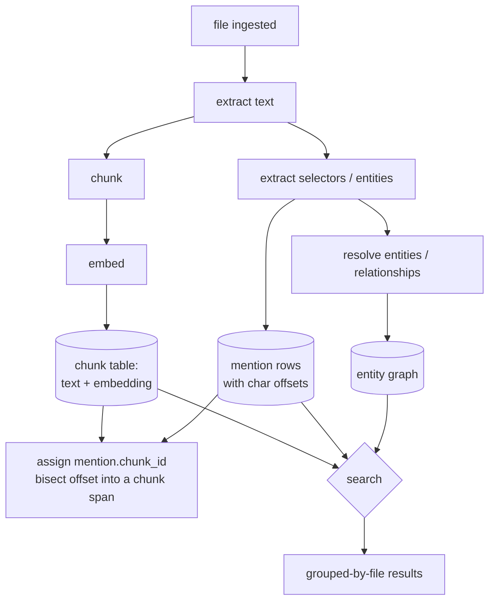

# Retrieval workflow (plain-language)

How a file becomes searchable, and how a search runs, end to end. This is the
map for reasoning about or changing the pipeline. Design rationale is in
`docs/retrieval-architecture.md`; vocabulary is in `docs/glossary.md`.

**One-line version:** a file's text is extracted once, split into `chunk`s, each
chunk is embedded and stored (Postgres or Elasticsearch — one setting,
`RETRIEVAL__BACKEND`); entity/identifier `mention`s found in that text are
tagged with which chunk they fall in; a search composes keyword + semantic +
entity/graph filtering in one call either way.

---

## The pieces

| Thing | Where it lives | What it is |
|---|---|---|
| `file` | Postgres `file` | one ingested artifact; has `sha256`, `filetype`, `filetype_group` |
| `extracted_text` | Postgres `extracted_text` | the whole plain-text of a file, one row per file |
| `chunk` | Postgres `chunk` **and/or** the ES `text_chunks` index | a slice of that text + its embedding. **The search store** — Postgres holds the full row (+ full-text vector) when it's the active backend; on Elasticsearch, ES holds the full doc and Postgres keeps a lightweight identity+span+text mirror (no embedding) so the next row still works |
| `mention` | Postgres `mention` | "this span of this file asserts entity X / identifier Y"; carries `chunk_id`, pointing at a `chunk` row regardless of which backend is active |
| `entity` / `entity_relationship` | Postgres | the knowledge graph mentions resolve into |

Entities and the graph **always** live in Postgres. The choice of retrieval
backend only changes where chunk text/embedding are searched — never where
`mention`/`entity`/`entity_relationship` live, and never how they're queried.

---

## Stage by stage

### 1. Ingest
A file is registered in `file` with its content hash (`sha256`) and type
(`filetype`, `filetype_group` = `document` / `email` / `image` / …). Two files
with the same bytes get the same `sha256`.

### 2. Extract text  — `extract-text`
Parsing / OCR produces the file's full plain text, written **once** to
`extracted_text.content` (one row per file). Nothing re-parses the file after
this. A detected language is recorded in `extracted_text.metadata`.

### 3. Chunk  — part of `embed-text`
The extracted text is split into overlapping-free slices ("chunks"), each with a
`start_offset` / `end_offset` back into `extracted_text.content`. Chunk size is
fixed so boundaries don't shift between runs.

### 4. Embed  — `embed-text`
Each chunk's text goes through the embedding model → one vector per chunk.

### 5. Store the chunk  — `embed-text`
Each chunk is written to the **`chunk` table**:

- `id` = `chunk_id_for(dataset_id, sha256, chunk_index, start_offset)` — a hash,
  **not random**. Re-running with the same chunking produces the same `id`, so a
  re-embed **updates** rows instead of making duplicates.
- `text`, `embedding`, the offsets, `dataset_id`, `file_id`, `filetype_group`.
- `language` — best-effort, from a detector if one runs; **not** required for
  search (the default keyword engine, `pg_search` with an ICU tokenizer, handles
  every script without knowing the language). Used only for optional result
  filtering / stemmer choice / display.
- The **keyword index** is built on `text` itself by `pg_search` (BM25, ICU) /
  `pgroonga` / `pg_bigm`. Only the `core` fallback ranker adds a `text_tsv`
  column (a per-language `tsvector`).
- `duplicate_file_ids` — see "Duplicate files" below.

### 6. Extract mentions  — `extract-selectors`, `extract-entities`
Regex (selectors: phones, emails, crypto, IDs, …) and NER (names, orgs, places)
run over `extracted_text.content` and produce `mention` rows. Each mention has
`file_id` + `start_offset` / `end_offset` into that text, plus `entity_type` /
`selector_type` / `selector_subtype` and a `normalized_value`.

### 7. Tag each mention with its chunk  — same step as 6
Right after a file's mentions are written, the workflow calls
`spans_for_file(file_id)` (one query: every chunk's `id` + span for that file)
and, for each mention, finds the chunk whose `[start_offset, end_offset)`
contains the mention's start (a binary search). That chunk's id is written to
`mention.chunk_id`. This is the join that makes "passages that mention X"
possible.

### 8. Resolve entities & relationships  — `resolve-entities`, `extract-relationships`
Mentions get linked to canonical `entity` rows; typed edges
(`emailed`, `has_selector`, …) are built in `entity_relationship`.
`resolve-entities` is the whole stage in one call (same names, match names, match new
entities, places, links -- see `docs/entity-resolution.md` §0).
Search doesn't depend on this having run — an unresolved mention still filters by
`selector_type` / `entity_type` — but graph-RAG (stage 9, `graph_expand`) does.

---

## How a search runs

Either backend answers `name = Bob AND term = soccer` in **one call** — how each
gets there differs, but a caller never sees a second query to merge.

**Postgres backend** — one SQL statement against `chunk`, joined to `mention`:

1. **Scope**: `WHERE dataset_id = … [AND filetype_group = …] [AND file_id = …]`.
2. **Keyword** (if a text query): the ranker's operator against `chunk.text` —
   `pg_search` BM25 (`text @@@ :query`) by default; `text_tsv @@ tsquery` only
   under the `core` fallback.
3. **Semantic** (if an embedding): score by `1 - (embedding <=> :query_vector)`
   (cosine), using the HNSW index.
4. **Hybrid**: run both orderings, combine by reciprocal-rank fusion.
5. **Entity filter** (if `entity_ids` / `entity_types` / `selector_types` /
   `selector_subtypes`): joined against `mention.chunk_id` — an `EXISTS` clause
   when something upstream (2–4) has already narrowed the candidates, or a plain
   `mention` scan resolved to a chunk-id list first when nothing has (browsing
   with only an entity/graph filter — see the architecture doc §10.2 for why
   that distinction matters at scale).
6. **Graph filter** (if `graph_expand`): a recursive CTE walks
   `entity_relationship` out from the seed entity (bounded depth / weight) to an
   entity-id set, folded into the same entity-filter step.
7. **Group by file**: `GROUP BY file_id`, return the top chunk per file + a match
   count, ordered by best score. Pagination is by file.

**Elasticsearch backend** — one ES query against `text_chunks`:

1–4 are the same BM25 / kNN / RRF query ES always ran.
5–6: entity/selector/graph filters are resolved by the **same** `mention` (+
`entity_relationship`) logic as steps 5–6 above — a Postgres query, since
entities live there regardless of backend — into a chunk-id list, applied as one
`{"terms": {"_id": [...]}}` filter ANDed into the ES query. Nothing is
denormalized onto the chunk doc to make this possible.
7. Grouping is ES's own `collapse` by `file_id`.

Drop any clause on either backend and it's still one round trip.

---

## What happens when…

**A file shares content with another (same `sha256`, same dataset).**
It is **not** chunked or embedded again. The existing `chunk` rows for that
content get the new `file_id` appended to `duplicate_file_ids`. A search scoped
to the new file still finds those chunks (`file_id = :f OR duplicate_file_ids @>
:f`). Mentions from the new file resolve to the shared chunk rows because the
join is by content position, not by `file_id`.

**A file is re-embedded (chunking unchanged).**
Same `chunk.id`s → rows are updated in place. `mention.chunk_id` still valid.

**A file is re-embedded with different chunking.**
`chunk.id`s change. The embed step deletes the file's old rows, writes new ones,
and re-points any existing `mention.chunk_id` for that file (re-run the stage-7
bisect).

**`reset-entities` is run.**
`mention` rows are deleted (so `mention.chunk_id` links vanish with them).
`chunk` rows are untouched — text search still works; entity filters return
nothing until extraction re-runs.

**A dataset is deleted.**
`chunk` rows cascade-delete with the dataset; `mention.chunk_id` was
`ON DELETE SET NULL` but the mentions cascade too.

**The configured `text_ranker`'s extension isn't installed.**
It downgrades one rung (`pg_search` → `pgroonga` → `bigm` → `core`); `core` is
built in and always works. On `core`, non-Latin ranking degrades to token-run
matching. Nothing errors. `GET /api/search/config` shows the effective ranker.
The ParadeDB dev image ships `pg_search`, so the default is silent there.

---

## Where to change things

| To change… | Edit |
|---|---|
| chunk size / splitting | `embed_text.py` (`_spans_for`, `DEFAULT_CHUNK_SIZE`) |
| what's stored per chunk | `chunk` table + `TextChunk` schema + `embed_text._build_chunk` |
| the deterministic id scheme | `chunk_id_for` in `cipher/schemas/content/search.py` |
| how a mention picks its chunk | stage-7 bisect in `extract_selectors.py` / `extract_entities.py` |
| the search query / ranking | `PostgresChunkRetrievalRepository.search` |
| keyword engine (BM25 / bigram / tsvector) | `RETRIEVAL__TEXT_RANKER` + the ranker-specific index in the P1b migration |
| language detection | extract-time detector / a `lingua` enrichment → `chunk.language` (optional) |
| entity/graph filter semantics | `RetrievalQuery` + the `EXISTS` clauses in `search` |
| which store backs search | `settings.retrieval.backend` + the `TextChunkDatastoreDep` factory |
