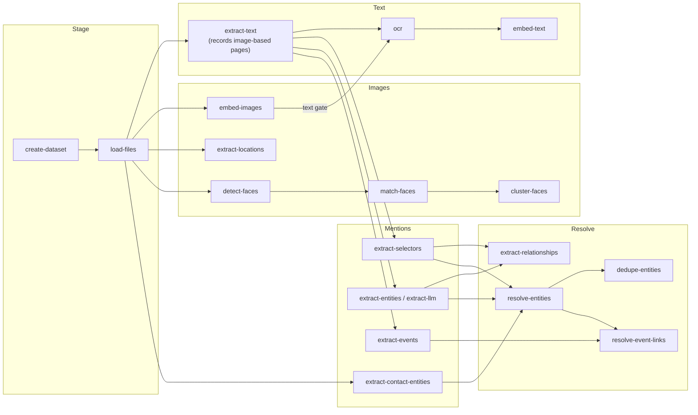

# Running analytics: the runbook

How to take a directory of files to a fully enriched dataset: which services to
start, which `cipher` commands to run, and in what order. Why each step exists and how
estimates work is in `docs/enrichments.md`; vocabulary is in `docs/glossary.md`.

**Not runnable from the frontend yet.** `POST /enrichments/run` only allows
`exif_location`. The dataset page shows progress (`/enrichments/progress/all`) and
estimates, but it can't start anything else. Run everything below from the CLI.

Every command can be re-run safely. Work is tracked per file in the `enrichment`
table (or deduped on a natural key), so a re-run picks up whatever is still pending.
Undo a step with the matching `reset-*` command (see [Redo / maintenance](#redo--maintenance)).

---

## 0. Setup

```bash
set -a; source .env; set +a                 # model dirs + LLM__* + DB settings
alias cipher='uv run --package cipher-orchestration cipher'
cipher --help                               # first call installs only the base CLI
```

**Environments install per stage, on demand.** The base `cipher` install is just
orchestration + datastores (+ the light pyselectors / pyprompt). Every command that
needs a heavy analytic re-launches itself as `uv run --extra <stage> cipher …`. The
first `detect-faces` installs `face`, the first `embed-text` installs `clir`, and so on,
all from `uv.lock`. Later calls only verify. Syncing is inexact, so one stage never
removes another's packages.

| Stage extra | Commands | Pulls in |
|---|---|---|
| `staging` | `load-files` | filetyper (magika) |
| `text-extraction` | `extract-text` | pyxberg (kreuzberg; EasyOCR only as the fallback OCR), pyparse[email] |
| `ocr` | `ocr` | pyocr client, pyxberg, setfitcv (CLIP filter) |
| `text-embedding` | `embed-text` | clir |
| `image-embedding` / `exif-location` | `embed-images` / `extract-locations` | setfitcv |
| `face-detection` | `detect-faces` | face[cuda] (InsightFace) |
| `contact-extraction` | `extract-contact-entities` | pyparse[contacts] |
| `event-extraction` | `extract-events`, `extract-llm` | pyparse (`extract-events --llm` also pulls `gliner` for the gate) |
| `gliner` / `nerd` | `extract-entities --extractor gliner\|nerd` | pygliner / nerd |

Variants: `CIPHER_STAGE_ENV_ISOLATED=1` gives each call a throwaway env (`uv run
--isolated`), which is the one-container-per-step shape an orchestrator would use.
`CIPHER_AUTO_ENV=0` runs in whatever env is active (e.g. `make install-cuda`, which
still installs everything). Implementation: `cipher/orchestration/environments.py` +
the extras in `pipelines/cipher-orchestration/pyproject.toml`.

| Needed by | Service / asset | How |
|---|---|---|
| everything | Postgres (ParadeDB image: pgvector + pg_search + PostGIS) | `.env` `POSTGRES__*`; `cipher create-tables` on a fresh DB |
| `embed-text`/`reset-text` only if `RETRIEVAL__BACKEND=elasticsearch` | Elasticsearch | `.env` `ELASTICSEARCH__*`. The default postgres backend never opens ES. |
| `ocr` | pyocr engine (jina-ocr-v1 on vLLM), local | Nothing to start: `cipher ocr` launches it from `analytics/pyocr/.venv-vllm` (`make install-vllm` once) and stops it afterwards. To keep one up, or one per GPU: `make start-vllm` (:8010) / `make start-vllm-all` + `--service-url` |
| `extract-llm`, `extract-entities --extractor llm`, `extract-events --llm` | LLM endpoint | `.env` `LLM__PROVIDER/MODEL/API_KEY` (or `LOCAL_LLM_BASE_URL`) |
| models | local checkpoints | `$TEXT_EMBEDDING_MODEL_DIR`, `$IMAGE_EMBEDDING_MODEL_DIR`, `$FACE_MODEL_DIR`, `$EASYOCR_MODEL_DIR`, `$GLINER_MODEL_DIR`, `$NERD_MODEL_DIR` |

`make start` (the API) isn't needed to run the pipeline. You need it to review the
results.

## Order at a glance



The text and image tracks don't depend on each other, so they can run at
the same time (on separate GPUs if you have them).

## 1. Stage

```bash
cipher create-dataset --name rag --description "..."
cipher load-files /data/rag --dataset-name rag          # file rows + filetype; sets date_staged
cipher estimate --dataset-name rag --device cuda        # optional: ETA per analytic
```

## 2. Text track

| # | Command | Notes |
|---|---|---|
| 2a | `cipher extract-text --dataset-name rag` | Parses emails (pyparse; attachments become child files), then documents (xberg). For every PDF it records its **image-based pages** (`metadata.image_pages`, read from xberg's per-page output) and leaves them for 2b. Keep `--chunk-size` the same as in 2c. |
| 2b | `cipher ocr --dataset-name rag` (after 3a) | Reads the image-based pages and text-bearing images with pyocr, merging page by page into the extracted text. Images pass a **gate** first: zero-shot CLIP tags over the embeddings from 3a, kept as each file's `has_text` **tag score**; under `--clip-threshold` (0.5) an image is not OCR'd (`--all-images` turns the gate off). A page that makes the model loop is cut back to one copy of the repeated text and counted in the run summary. |
| 2c | `cipher embed-text --dataset-name rag --model-dir $TEXT_EMBEDDING_MODEL_DIR --device cuda` | Writes the chunks that power keyword, semantic and entity search. `--max-pages N` limits very long documents. |

## 3. Image track

| # | Command | Notes |
|---|---|---|
| 3a | `cipher embed-images --dataset-name rag --model-dir $IMAGE_EMBEDDING_MODEL_DIR --device cuda` | CLIP embeddings for image search. Also required by the `ocr` CLIP filter. |
| 3b | `cipher extract-locations --dataset-name rag` | EXIF GPS → `location` rows (no model). **The only step you can also start from the UI.** |
| 3c | `cipher detect-faces --dataset-name rag --model-dir $FACE_MODEL_DIR --device cuda` | |
| 3d | `cipher match-faces --dataset-name rag` | Proposes pending face→person matches against existing people. Only useful once people exist. |
| 3e | `cipher cluster-faces --dataset-name rag` | Groups the remaining faces into unnamed persons. |
| (3f) | `cipher link-face-cooccurrence` | Runs automatically after 3d/3e. Run it by hand after reviewing faces in the UI. |

## 4. Mentions (after 2a)

These can run in any order, but after 2b: OCR'd text is only seen by what runs after it.

| Command | Produces |
|---|---|
| `cipher extract-selectors --dataset-name rag` | Email-header participants + pyselectors spans (phone, email, IBAN, …) |
| `cipher extract-entities --dataset-name rag --extractor gliner --gliner-model-dir $GLINER_MODEL_DIR --device cuda` | person / org / location name mentions + relations. Engines: `llm` (default), `gliner`, `nerd`. |
| `cipher extract-events --dataset-name rag` | `.ics` → events (deterministic) |
| `cipher extract-contact-entities --dataset-name rag` | Parses vCard files into `contact` rows, then name + selector mentions and `member_of` for orgs |

**LLM events:** `cipher extract-events --dataset-name rag --llm-only --gliner-model-dir $GLINER_MODEL_DIR --device cuda`
gates every email with GLiNER, sends the likely ones (plus a 5% sample of the
rest) to the LLM, tags each file read `event` positive or negative, and prints a
gate report. `--no-gate` reads everything.

**LLM option:** `cipher extract-llm --dataset-name rag --concurrency 16` covers LLM
entities *and* events in one model call per email. It replaces
`extract-entities --extractor llm` plus `extract-events --llm`. It's slow (a full
mailbox takes overnight), and runs over 15,000 files are refused unless you pass
`--yes`. Try a `--limit 200` slice first.

## 5. Resolve (after the step 4 commands you're using)

| # | Command | Notes |
|---|---|---|
| 5a | `cipher extract-relationships --dataset-name rag` | Directed `emailed` edges, sender → recipient address, weight = emails sent that way. Needs no resolution; feeds `top_connections`. |
| 5b | `cipher resolve-entities --dataset-name rag --concurrency 8` | Matches mention groups to entities: auto-attach, send to review, or create a provisional entity. `--concurrency` makes it about 6× faster. |
| 5b′ | `cipher resolve-locations --dataset-name rag` | Place mentions → shared country / state / city / region entities via the offline gazetteer (`cipher-places-build` once, writes `~/models/gazetteer/`). Per mention, using nearby text (`Dover, DE 19904` → Delaware); ambiguous names (`Washington`, `Georgia`) stay unresolved. Runs automatically at the end of 5b (`--skip-locations` to opt out). Matches dictionary forms in any indexed language, then lemmas (ru/uk case forms, ar/fa prefixes, zh suffixes). Places are entities, not map points. Own places: `~/models/gazetteer/custom_places.jsonl` + rebuild (see `libs/cipher-places/README.md`). |
| 5c | `cipher dedupe-entities --dataset-name rag` | Proposes merges between provisional and canonical entities (always goes to review) |
| 5d | `cipher resolve-event-links --dataset-name rag` | Links event participants and places to entities / locations |

## 6. Review (the UI)

Start `make start` and the frontend. The dataset page shows progress per analytic.
Then review in: **Entities → Resolve** (pending matches + duplicate merges), **Faces /
Persons** (pending face matches, unnamed clusters), **Events**. A file's **Text** tab
flags image-based pages and which OCR produced their text. After confirming faces,
re-run `link-face-cooccurrence`. After confirming entities, re-running 5b/5c picks up
what changed.

## Full copy-paste (GPU box, gliner NER, no LLM)

```bash
D=rag
cipher create-dataset --name $D
cipher load-files /data/$D --dataset-name $D
cipher extract-text  --dataset-name $D
cipher embed-images  --dataset-name $D --model-dir $IMAGE_EMBEDDING_MODEL_DIR --device cuda
cipher ocr           --dataset-name $D
cipher embed-text    --dataset-name $D --model-dir $TEXT_EMBEDDING_MODEL_DIR --device cuda
cipher extract-locations --dataset-name $D
cipher detect-faces  --dataset-name $D --model-dir $FACE_MODEL_DIR --device cuda
cipher match-faces   --dataset-name $D
cipher cluster-faces --dataset-name $D
cipher extract-selectors --dataset-name $D
cipher extract-entities  --dataset-name $D --extractor gliner --gliner-model-dir $GLINER_MODEL_DIR --device cuda
cipher extract-events    --dataset-name $D
cipher extract-contact-entities  --dataset-name $D
cipher extract-relationships --dataset-name $D
cipher resolve-entities  --dataset-name $D --concurrency 8
cipher dedupe-entities   --dataset-name $D
cipher resolve-event-links --dataset-name $D
cipher stats --dataset-name $D
```

## Redo / maintenance

| Situation | Run |
|---|---|
| OCR added after the fact, or re-done | `ocr` → `embed-text` (OCR re-queues the files it rewrote); mentions extracted before it need `reset-entities` + step 4 |
| No GPU / pyocr engine not installed | `extract-text --ocr-backend easyocr` OCRs image-based pages inline (English by default, `--ocr-language`; much weaker on poor scans) and skip `ocr` |
| Changed chunk size or embedding model | `reset-text` → `extract-text` → (`ocr`) → `embed-text` (then re-run mentions: offsets moved) |
| Re-extract entities/selectors from scratch | `reset-entities` → step 4 → step 5 (manual entities are kept) |
| Re-extract events | `reset-events` → `extract-events` → `resolve-event-links` (manual/verified events are kept) |
| Undo face matches / clusters | `match-faces --reset`, `cluster-faces --reset [--reset-verified]` |
| `cipher-names` upgraded | `backfill-entity-name-keys [--purge]` |
| `pyselectors` packs updated | `refresh-selectors` |
| Old dataset, mentions missing `chunk_id` | `backfill-mention-chunks` |
| `RETRIEVAL__BACKEND=elasticsearch` only | `sync-chunk-entities` after step 4 (`--purge` after `reset-entities`) |
| Check throughput / calibrate estimates | `cipher rates`, `cipher estimate --dataset-name X` |

## What it would take to run this from the frontend

The pieces already exist: the dependency order (`resolve_enrichment_order`), the
estimates, the analytics list and parameters collected by the request wizard
(`ANALYTIC_PARAM_MODELS`), progress tracking per enrichment, and now a per-stage env
per command (`ensure_stage_env`). What's missing is a **runner**: a worker that takes
a dataset + list of analytics and runs the matching `cipher` commands in order, each
as `uv run --extra <stage>` (or a container per stage). It would stream progress from
`enrichment` and report failures. `BackgroundTasks` works for EXIF, but it can't
handle GPU jobs that run for hours.

**Messages are paused.** The phone-dump (SMS/MMS) workflows are removed from the
pipeline for now; the `message` table and the message search API remain.
