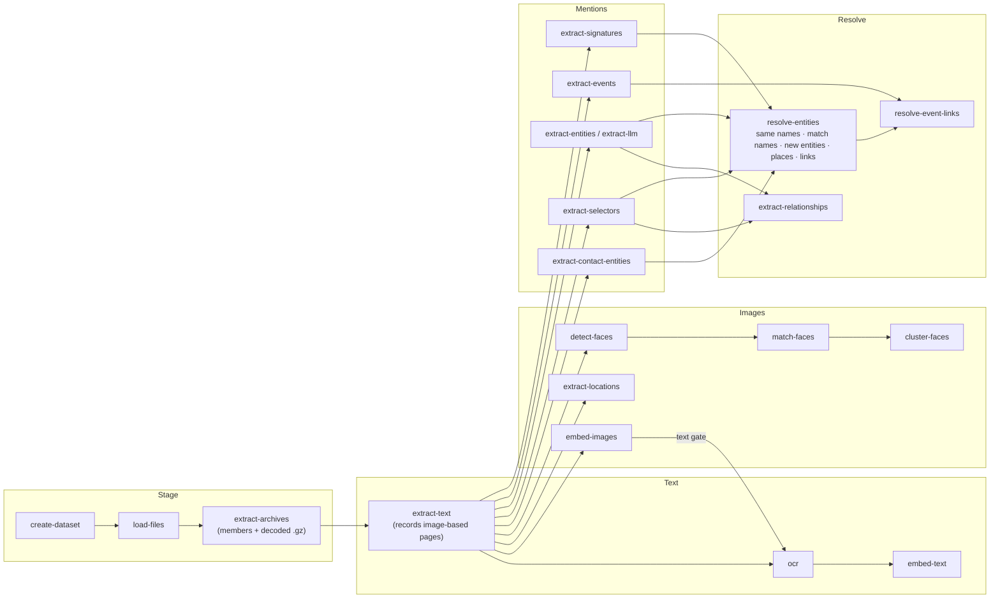

# Running analytics: the runbook

How to take a directory of files to a fully enriched dataset: which services to
start, which `cipher` commands to run, and in what order. Why each step exists and how
estimates work is in `docs/enrichments.md`; every command (pipeline steps, maintenance like
`rekey`, benchmarks) is in `docs/cli.md`; vocabulary is in `docs/glossary.md`.

**Not runnable from the frontend yet.** `POST /enrichments/run` only allows
`exif_location`. The dataset page shows progress (`/enrichments/progress/all`) and
estimates, but it can't start anything else. Run everything below from the CLI.

Every command can be re-run safely. Work is tracked per file in the `enrichment`
table (or deduped on a natural key), so a re-run picks up whatever is still pending.
Undo a step with the matching `reset-*` command (see [Redo / maintenance](#redo--maintenance)).

---

## 0. Setup

```bash
set -a; source .env; set +a                 # model dirs + LLM__* + DB settings
alias cipher='uv run --package cipher-orchestration cipher'
cipher --help                               # first call installs only the base CLI
```

**Environments install per stage, on demand.** The base `cipher` install is just
orchestration + datastores (+ the light pyselectors / pyprompt). Every command that
needs a heavy analytic re-launches itself as `uv run --extra <stage> cipher …`. The
first `detect-faces` installs `face`, the first `embed-text` installs `clir`, and so on,
all from `uv.lock`. Later calls only verify. Syncing is inexact, so one stage never
removes another's packages.

| Stage extra | Commands | Pulls in |
|---|---|---|
| `staging` | `load-files` | filetyper (magika) |
| `text-extraction` | `extract-text` | pyxberg (kreuzberg; EasyOCR only as the fallback OCR), pyparse[email] |
| `ocr` | `ocr` | pyvllm[indra] (jina-ocr-v1 client + model launcher; Indra OCR in-process), pyxberg, setfitcv (CLIP filter) |
| `text-embedding` | `embed-text` | clir |
| `image-embedding` / `exif-location` | `embed-images` / `extract-locations` | setfitcv |
| `face-detection` | `detect-faces` | face[cuda] (InsightFace) |
| `contact-extraction` | `extract-contact-entities` | pyparse[contacts] |
| `event-extraction` | `extract-events`, `extract-llm` | pyparse (`extract-events --llm` also pulls `gliner` for the gate) |
| `gliner` / `nerd` | `extract-entities --extractor gliner\|nerd` | pygliner / nerd |

Variants: `CIPHER_STAGE_ENV_ISOLATED=1` gives each call a throwaway env (`uv run
--isolated`), which is the one-container-per-step shape an orchestrator would use.
`CIPHER_AUTO_ENV=0` runs in whatever env is active (e.g. `make install-cuda`, which
still installs everything). Implementation: `cipher/orchestration/environments.py` +
the extras in `pipelines/cipher-orchestration/pyproject.toml`.

| Needed by | Service / asset | How |
|---|---|---|
| everything | Postgres (ParadeDB image: pgvector + pg_search + PostGIS) | `.env` `POSTGRES__*`; `cipher create-tables` on a fresh DB |
| `embed-text`/`reset-text` only if `RETRIEVAL__BACKEND=elasticsearch` | Elasticsearch | `.env` `ELASTICSEARCH__*`. The default postgres backend never opens ES. |
| `ocr` (default `--engine jina`) | pyvllm's `ocr` model (jina-ocr-v1 on vLLM), local, GPU 0 | Nothing to start: `cipher ocr` launches it (`make install` + `make download` in `analytics/pyvllm` once) and stops it afterwards. To keep it up: `pyvllm up ocr`; more GPUs: one server each + repeat `--service-url` |
| `ocr --engine indra` | Indra OCR weights (~76 MB, CPU) | No server: runs inside `cipher ocr`. `make download-indra` in `analytics/pyvllm` once (or `$INDRA_OCR_MODEL_DIR` for an offline copy). See [Choosing an OCR engine](#choosing-an-ocr-engine) |
| chat, `extract-llm`, `extract-entities --extractor llm`, `extract-events --llm` | LLM endpoint | Local: pyvllm's `llm` model (Qwen3.8-27B on GPU 1, :8008) -- `pyvllm up llm` in `analytics/pyvllm`, kept running. `.env` `LLM__PROVIDER=local`, `LLM__MODEL=Qwen/Qwen3.8-27B`, `LLM__API_KEY` = `VLLM_API_KEY`. Hosted providers work the same way via `LLM__*`. |
| models | local checkpoints | `$TEXT_EMBEDDING_MODEL_DIR`, `$IMAGE_EMBEDDING_MODEL_DIR`, `$FACE_MODEL_DIR`, `$EASYOCR_MODEL_DIR`, `$GLINER_MODEL_DIR`, `$NERD_MODEL_DIR` |

`make start` (the API) isn't needed to run the pipeline. You need it to review the
results.

## Order at a glance



**Unpack first.** Archive members and decoded compressed files don't exist as
files until `extract-archives` has run, and an email's attachments don't exist
until its email is parsed (2a), so every file analytic runs after 2a's email pass.
`extract-text` unpacks for you: archives first, then emails and unpacking in turn
until neither finds anything new (a zip can hold an email that attaches another
zip), then documents. After 2a the text and image tracks don't depend on each
other, so they can run at the same time (on separate GPUs if you have them).

## 0. From the app (run plans)

The steps below can also run without a terminal: users request a dataset or analytics as a
GitHub issue; an admin queues the steps from the dataset page's enrichment pipeline (Run
selected, or a row's `⋯` menu), and `cipher worker` processes on each host run them in order
(`docs/pipeline-runner.md`):

```bash
cipher worker --pool cpu --slots 2      # each CPU host (LLM steps call the LLM service from here)
cipher worker --pool gpu                # the GPU host: one step per GPU (embeddings, faces, NER, OCR)
```

## 1. Stage

```bash
cipher create-dataset --name rag --description "..."
cipher load-files /data/rag --dataset-name rag          # or s3://bucket/prefix/; --include/--exclude globs; sets date_staged
cipher extract-archives --dataset-name rag              # optional on its own: extract-text runs it first
cipher estimate --dataset-name rag --device cuda        # optional: ETA per analytic
```

`extract-archives` turns zip and tar members (also `.tar.gz` / `.xz` / `.bz2` /
`.zst`) into files with `parent_id` set to the archive, their bytes in the output store
(`<OUTPUT_URI>/<dataset id>/`, `OUTPUT_URI` default `~/data/cipher/output`, or
`--output-uri`; a directory or `s3://bucket/prefix`), and decodes files found compressed
(`report.csv.gz` becomes the csv, in its own row). Nested archives open pass by pass to
`--max-depth` (5); copies of an archive already unpacked are skipped; limits stop zip
bombs and full disks per archive (`docs/archive-extraction.md`). A killed run resumes
where it stopped: claims of a run that stopped heartbeating go back to the queue (a live
run keeps its own, so two hosts can share a step).

7z / rar / iso / cab need the official static 7-Zip: put `7zzs` from the
[ip7z/7zip release](https://github.com/ip7z/7zip/releases) at
`~/.local/share/cipher/bin/7zz` (or set `SEVENZIP_PATH`). Without it (or without the
zstd / lz4 decoders for `.zst` / `.lz4`) those archives fail as `missing: ...`, the command
ends with an `ERROR:` line saying what to install and exits 1, and the next run after
installing picks them up. It always runs in a
pure-Python sandbox (no network, only the archive readable, only scratch writable) built
from Linux kernel features, with nothing to install; `uv run pyarchive sandbox` checks a
machine. `--sandbox required` fails those archives where it can't fully apply, and
`--sandbox off` runs 7-Zip unconfined where the sandbox gets in its way.

Encrypted archives: put known passwords in `~/data/cipher/archive-passwords.txt`
(`ARCHIVE_PASSWORDS_FILE`; one per line, `chmod 600`). Every unpack tries them in order, and
after you add one, the next `extract-archives` goes back to archives with encrypted members
and extracts only what's still missing.

## 2. Text track

| # | Command | Notes |
|---|---|---|
| 2a | `cipher extract-text --dataset-name rag` | Unpacks archives, then parses emails (pyparse; attachments become child files) and unpacks again until nothing new turns up, then documents (xberg). `--no-archives` skips unpacking. For every PDF it records its **image-based pages** (`metadata.image_pages`, read from xberg's per-page output) and leaves them for 2b. Keep `--chunk-size` the same as in 2c. |
| 2b | `cipher ocr --dataset-name rag` (after 3a) | Reads the image-based pages and text-bearing images with pyvllm's `ocr` model, merging page by page into the extracted text. Images pass a **gate** first: zero-shot CLIP tags over the embeddings from 3a, kept as each file's `has_text` **tag score**; under `--clip-threshold` (0.5) an image is not OCR'd (`--all-images` turns the gate off). A page that makes the model loop is cut back to one copy of the repeated text and counted in the run summary. |
| 2c | `cipher embed-text --dataset-name rag --model-dir $TEXT_EMBEDDING_MODEL_DIR --device cuda` | Writes the chunks that power keyword, semantic and entity search. `--max-pages N` limits very long documents. |

### Choosing an OCR engine

`cipher ocr --engine jina|indra` (request form: **OCR → Engine**). Both read the same pages -- image-based
PDF pages and images past the CLIP gate -- and write the same merged extracted text, tables included;
`DocumentMetadata.ocr_model` records which one did (`jinaai/jina-ocr-v1` or `datalab-to/indra-ocr`).

| | `jina` (default) | `indra` |
|---|---|---|
| Model | jina-ocr-v1: a vision-language model that writes each page as markdown | Indra OCR (Datalab): line detection + a small recogniser (CTC: one pass per line, no token-by-token generation) + reading order, on ONNX |
| Runs | GPU, behind pyvllm's local vLLM server (:8010), started and stopped by the step | CPU, in the `cipher ocr` process (`--workers` processes); no server, no GPU |
| Run plan pool | `gpu` | `cpu` |
| Speed here | GPU-bound; vLLM batches every page in flight | ~5.5 pages/s with `--workers 8` on this 20-thread box (forced OCR, 60 pages); more workers than physical cores didn't help |
| Best at | Degraded or noisy scans, photos of documents, handwriting, complex or borderless tables, mixed layouts | Clean printed scans and screenshots, many languages: Latin, Cyrillic, Greek, CJK, Arabic / Persian / Urdu / Hebrew, Devanagari and other Indic scripts, Thai, Georgian, Armenian, Ethiopic |
| Weak at | Throughput when no GPU is free; it can loop on a page (cut back and counted as "cut short") | Handwriting (25% on its own benchmark), degraded scans, merged-cell or unruled tables, charts (read as cell grids); scripts outside its list (Syriac, Tibetan, Mongolian) |
| Figures | `--figures` locates and captions them | Not supported (`--figures` is ignored with a warning) |
| Licence | CC BY-NC 4.0: non-commercial without a Jina AI agreement | Code Apache-2.0; weights modified OpenRAIL-M: free for research, personal use and organisations under $20M funding/revenue, not for competing with Datalab's API |

When to use which:

* **No free GPU, a CPU worker host, or a large pile of clean scans** → `indra`. It also starts in seconds
  (no model server to bring up), so it suits small top-up runs.
* **Poor scans, phone photos of paper, handwriting, forms and tables you will rely on** → `jina`.
* **Unsure** → run `indra` on a sample dataset and read a few OCR'd files on the file page; if the text is
  garbled or tables are scrambled, use `jina` for that data.

Files already OCR'd are not read again by a later run with the other engine (their OCR step is done);
content-identical copies only reuse text the same engine wrote.

## 3. Image track (after 2a's email pass, so attachment and archive images exist)

| # | Command | Notes |
|---|---|---|
| 3a | `cipher embed-images --dataset-name rag --model-dir $IMAGE_EMBEDDING_MODEL_DIR --device cuda` | CLIP embeddings for image search. Also required by the `ocr` CLIP filter. |
| 3b | `cipher extract-locations --dataset-name rag` | EXIF GPS → `location` rows (no model). **The only step you can also start from the UI.** |
| 3c | `cipher detect-faces --dataset-name rag --model-dir $FACE_MODEL_DIR --device cuda` | |
| 3d | `cipher match-faces --dataset-name rag` | Proposes pending face→person matches against existing people. Only useful once people exist. |
| 3e | `cipher cluster-faces --dataset-name rag` | Groups the remaining faces into unnamed persons. |
| (3f) | `cipher link-face-cooccurrence` | Runs automatically after 3d/3e. Run it by hand after reviewing faces in the UI. |

## 4. Mentions (after 2a)

These can run in any order, but after 2b: OCR'd text is only seen by what runs after it.

| Command | Produces |
|---|---|
| `cipher extract-selectors --dataset-name rag` | Email-header participants + pyselectors spans (phone, email, IBAN, …) |
| `cipher extract-entities --dataset-name rag --extractor gliner --gliner-model-dir $GLINER_MODEL_DIR --device cuda` | person / org / location name mentions + relations. Engines: `nerd` (default), `gliner`, `llm`. |
| `cipher extract-events --dataset-name rag` | `.ics` → events (deterministic) |
| `cipher extract-contact-entities --dataset-name rag` | Parses vCard files into `contact` rows, then name + selector mentions and `member_of` for orgs |
| `cipher extract-signatures --dataset-name rag [--rebuild]` | Who each sender works for -- see **`docs/signatures.md`**. First pass (rules): skip Gmail bulk mail (`--include-bulk` to read it); the last 15 lines the sender wrote become a candidate only when there is a signer cue (farewell phrase, sender's name/address, NER person) **and** something to learn (NER organization, phone, website, another email address) -- ~5% of a mailbox. Run `extract-entities` first for the NER cues. The local LLM decides whether it's a signature and copies out company → division → department, role, phones/emails/websites/addresses; code then checks it (verbatim, signer = sender, not a brand). Enrichment-gated; a sender's known signature is reused without another call. Each address's city comes from the gazetteer (left out when ambiguous); phones are kept as written, with a country only when the number states one. Then `resolve-entities` resolves the names; review on the Entities page's **Email signatures** tab (label fixes in the text, accept / correct / reject / add relationships). Languages: `signature_cues.py` |

**LLM events:** `cipher extract-events --dataset-name rag --llm-only --gliner-model-dir $GLINER_MODEL_DIR --device cuda` -- the same call also reads **memberships** (recipient `member_of` an organization, with its address; see `docs/events.md`). Run `extract-selectors` first so the recipient's header name exists.
gates every email with GLiNER, sends the likely ones (plus a 5% sample of the
rest) to the LLM, tags each file read `event` positive or negative, and prints a
gate report. `--no-gate` reads everything.

**LLM option:** `cipher extract-llm --dataset-name rag --concurrency 16` covers LLM
entities *and* events in one model call per email. It replaces
`extract-entities --extractor llm` plus `extract-events --llm`. It's slow (a full
mailbox takes overnight), and runs over 15,000 files are refused unless you pass
`--yes`. Try a `--limit 200` slice first.

## 5. Resolve (after the step 4 commands you're using)

| # | Command | Notes |
|---|---|---|
| 5a | `cipher extract-relationships --dataset-name rag` | Directed `emailed` edges, sender → recipient address, weight = emails sent that way. Needs no resolution; feeds `top_connections`. |
| 5b | `cipher resolve-entities --dataset-name rag` | **The whole resolution stage in one call**, one unit per name key (`Adaire`, `Adaire's`, `Adaire (no reply)`, any type): (1) *same names* -- auto-created duplicates fold, names attach to their auto-created entity; (2) *match names* -- the rest are scored: attach, suggest (Resolve), or create **one** entity per unit; (2b) *short names in context* -- `Nick` in an email that names Nick Bolton becomes him; (3) *match new entities* -- auto-created entities new since the last run → merge suggestions (Verify; `--full` rescores all); (4) places (5b′); (5) links and suggestions (header identifiers, relationships, email domains, event participants, family from patronymics). Progress per step shows on the dataset page. `--concurrency` (default 8) runs units in parallel. Design: `docs/entity-resolution.md` §0. |
| 5b′ | `cipher resolve-locations --dataset-name rag` | Place mentions → shared country / state / city / region entities via the offline gazetteer (index + sources committed in `libs/cipher-places/data/`; skipped with a warning if the index is missing). Per mention, using nearby text (`Dover, DE 19904` → Delaware); ambiguous names (`Washington`, `Georgia`) stay unresolved. Runs automatically at the end of 5b (`--skip-locations` to opt out). Matches dictionary forms in any indexed language, then lemmas (ru/uk case forms, ar/fa prefixes, zh suffixes). Places are entities, not map points. Own places: `uv run libs/cipher-places/scripts/add_place.py NAME LAT LON --alias ...` (see `libs/cipher-places/README.md`). |
| 5d | `cipher resolve-event-links --dataset-name rag` | Links event participants and places to entities / locations. Also runs inside 5b; on its own after `extract-events` alone. |

## 6. Review (the UI)

Start `make start` and the frontend. The dataset page shows progress per analytic.
Then review **Entities** -- **Verify** (auto-created entities, biggest first, each with its
possible duplicates to merge or keep apart), then **Resolve** (names still without an
entity) -- then **Faces / Persons** (pending face
matches, unnamed clusters) and **Events**. A file's **Text** tab
flags image-based pages and which OCR produced their text. After confirming faces,
re-run `link-face-cooccurrence`. After a batch of entity decisions, re-running 5b picks
up what changed (folded names send their old spellings straight to the survivor).

## Full copy-paste (GPU box, gliner NER, no LLM)

```bash
D=rag
cipher create-dataset --name $D
cipher load-files /data/$D --dataset-name $D
cipher extract-text  --dataset-name $D           # unpacks archives first (extract-archives)
cipher embed-images  --dataset-name $D --model-dir $IMAGE_EMBEDDING_MODEL_DIR --device cuda
cipher ocr           --dataset-name $D
cipher embed-text    --dataset-name $D --model-dir $TEXT_EMBEDDING_MODEL_DIR --device cuda
cipher extract-locations --dataset-name $D
cipher detect-faces  --dataset-name $D --model-dir $FACE_MODEL_DIR --device cuda
cipher match-faces   --dataset-name $D
cipher cluster-faces --dataset-name $D
cipher extract-selectors --dataset-name $D
cipher extract-entities  --dataset-name $D --extractor gliner --gliner-model-dir $GLINER_MODEL_DIR --device cuda
cipher extract-events    --dataset-name $D
cipher extract-contact-entities  --dataset-name $D
cipher extract-signatures --dataset-name $D
cipher extract-relationships --dataset-name $D
cipher resolve-entities  --dataset-name $D   # the whole resolution stage
cipher stats --dataset-name $D
```

## Redo / maintenance

| Situation | Run |
|---|---|
| OCR added after the fact, or re-done | `ocr` → `embed-text` (OCR re-queues the files it rewrote); mentions extracted before it need `reset-entities` + step 4 |
| No GPU | `ocr --engine indra` (CPU, in-process; see [Choosing an OCR engine](#choosing-an-ocr-engine)). Last resort: `extract-text --ocr-backend easyocr` OCRs image-based pages inline (English by default, `--ocr-language`; much weaker on poor scans) and skip `ocr` |
| Changed chunk size or embedding model | `reset-text` → `extract-text` → (`ocr`) → `embed-text` (then re-run mentions: offsets moved) |
| Re-extract entities/selectors from scratch | `reset-entities` → step 4 → step 5 (manual entities are kept) |
| Re-extract events | `reset-events` → `extract-events` → `resolve-event-links` (manual/verified events are kept) |
| Undo face matches / clusters | `match-faces --reset`, `cluster-faces --reset [--reset-verified]` |
| Changed normalization code (`normalize_name`, cipher-names, pyselectors) | `rekey [--names \| --name-keys \| --selectors] [--dry-run]` → `resolve-entities` after a names re-key; `--purge-name-keys` after a cipher-names `KEYS_VERSION` bump. See `docs/cli.md` |
| Mentions missing `chunk_id` (extracted before the chunks existed) | nothing extra: `embed-text` re-anchors them when it finishes |
| Check throughput / calibrate estimates | `cipher rates`, `cipher estimate --dataset-name X` |
| Changed filetyper (registry, compression look-inside) | `rekey --filetypes [--dry-run]` → `extract-archives` (files now typed as archives or compressed) → `extract-text` (files now typed as documents) |
| Added archive passwords | `extract-archives` (archives with encrypted members are retried) → `extract-text` |
| An archive failed (corrupt, a limit) | `retry-failed archive_extraction --dataset-name X` → `extract-archives` (raise the limit option it names first) |

## What it would take to run this from the frontend

The pieces already exist: the dependency order (`resolve_enrichment_order`), the
estimates, the analytics list and parameters collected by the request wizard
(`ANALYTIC_PARAM_MODELS`), progress tracking per enrichment, and now a per-stage env
per command (`ensure_stage_env`). What's missing is a **runner**: a worker that takes
a dataset + list of analytics and runs the matching `cipher` commands in order, each
as `uv run --extra <stage>` (or a container per stage). It would stream progress from
`enrichment` and report failures. `BackgroundTasks` works for EXIF, but it can't
handle GPU jobs that run for hours.

**Messages are paused.** The phone-dump (SMS/MMS) workflows are removed from the
pipeline for now; the `message` table and the message search API remain.
